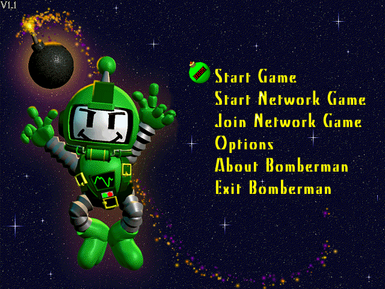
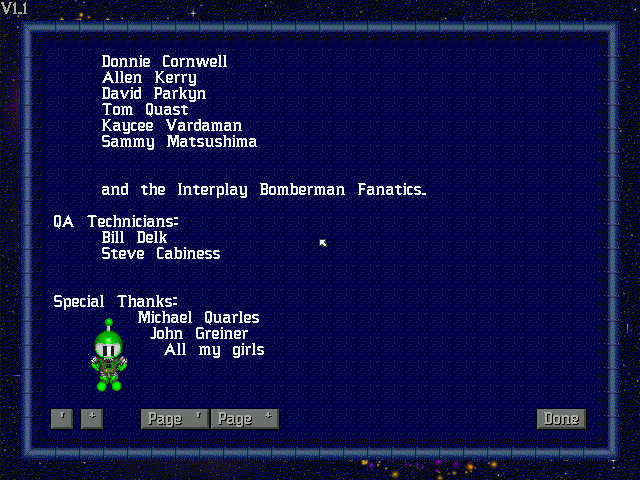
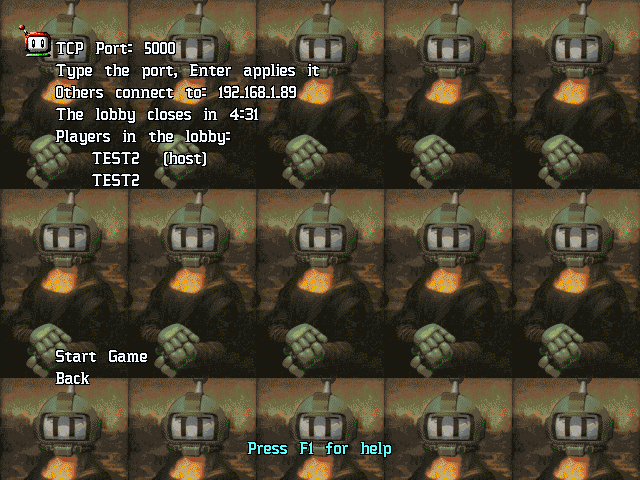
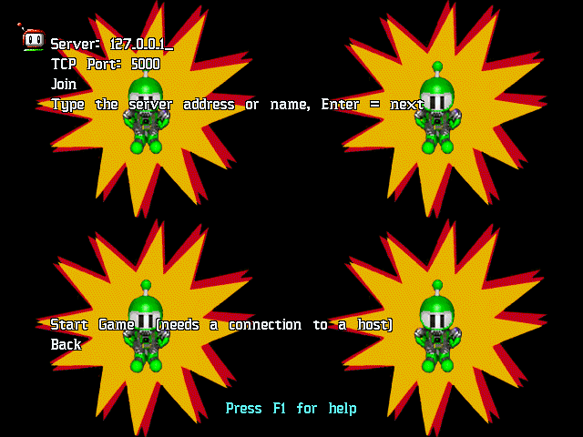

# Atomic Bomberman (1997) – restored source, Windows 7–11, TCP network play

> **Credits and ownership.** I claim **no credit and no ownership** over the original Atomic Bomberman game
> code, graphics, sound or design. Atomic Bomberman is the work of **Hudson Soft / Interplay (1997)** and
> belongs to its rightful owners. All I did is *fix 30-year-old software* so that it runs again on current
> systems: the build tooling, the Windows compatibility layer, the TCP networking, the dedicated server, the
> asset converters and the bug fixes in this repository. This is an unofficial fan preservation project, not
> affiliated with or endorsed by the original authors or publishers.
>
> **This repository contains no original game files.** The original executable and the game's data (graphics,
> sound, levels, texts) are **not** included and are not redistributed. You need your own legitimate copy of the
> game to build and play. Anyone can read, pull and fork this repository; only the owner pushes and merges.

This project takes the original `BM95.EXE` (Hudson Soft / Interplay, 1997), restores its
assembly source, replaces the IPX network layer with TCP, and converts the DOS-era assets
to PNG / Ogg Vorbis.  It needs a legitimate copy of the game to convert the assets from.

| | original | now |
|---|---|---|
| assets | 462 MB (2027 raw sounds, 62 PCX, ...) | **71 MB** (`dist/`) |
| network | IPX / modem / serial | **TCP** (host on a port, or join IP:port) + modem / serial |
| Windows | crashes on current Windows (see below) | starts from any folder, Win 7 – 11 |

## Screenshots
Frames of the running game (the artwork belongs to the original authors, see the credits above).

| Main menu | About |
|---|---|
|  |  |

| Start Network Game: the server lobby | Join Network Game |
|---|---|
|  |  |

In the server lobby the TCP port is at the top (type to change it, Enter applies it), the players that have connected are
listed, and any player can press *Start Game*. On the join screen the server address and port are edited in place (a
blinking `_` shows which field you are in); Enter moves on, *Join* connects.

## Dedicated server
A server that has **no player of its own** and takes up to 10 players. It is a small Python program
(`DedicatedServer/`, standard library only, Python 3.7+) that runs on Windows, Linux, macOS and Raspberry Pi.

**Install and start**

| System | Install what is needed | Start |
|---|---|---|
| Windows | `DedicatedServer\setup.cmd` (installs Python if it is missing) | `DedicatedServer\start.cmd` |
| Linux / Raspberry Pi / macOS | `./setup.sh` (installs Python 3 with the system package manager if missing) | `./start.sh` |
| Linux, always on (systemd) | `sudo ./install_service.sh` | starts at boot, restarts if it stops; remove with `sudo ./uninstall_service.sh` |

**Settings** are in `DedicatedServer/server.ini` (restart the server after editing it):

```ini
[server]
name = Atomic Bomberman Dedicated Server   ; shown in the server log
port = 5000                                ; TCP port the players connect to
bind = 0.0.0.0                             ; listen on every network interface
max_players = 10                           ; 1 - 10
fuse_seconds = 4                           ; a player silent for this long is dropped
log_file = server.log                      ; empty = console only
```

**Play through it**
1. Start the server and open the TCP port (`port` in `server.ini`) in the firewall / router if players connect from outside your network.
2. Every player starts the game and chooses **Join Network Game**, types the server's address and port, and presses **Join**. Nobody uses *Start Network Game*.
3. All players see the same lobby. Any player can press **Start Game**; then everyone lands on the player setup screen, presses **Enter** to lock their position, and the match starts when everyone has locked.
4. The first player to connect (node 1) runs the game's server logic on their computer; if that player leaves during a game, everybody returns to the join screen. When the last player leaves the server is empty and ready again.

**Check it** with `python DedicatedServer/tests/selftest.py` (fake players against a real server process). More details: [DedicatedServer/README.md](DedicatedServer/README.md).

## Play

```
dist\AtomicBomberman.exe                      normal start
dist\AtomicBomberman.exe -skipintro           straight to the main menu
dist\AtomicBomberman.exe -host 5000           host on TCP port 5000 without the lobby screen (scripts / tests)
dist\AtomicBomberman.exe -join 10.0.0.7:5000  join without the join screen
dist\AtomicBomberman.exe -local               networking off
```

The game runs in a normal window (scaled to the screen; `BM_SCALE=200` forces 200 %), the mouse
pointer stays visible, it keeps running when the window is in the background, and TCP is the only
network protocol (IPX, modem and serial are gone).  The version in the main menu reads V1.1 and the
"Online Manual" entry is removed.

All network screens are the game's own (same font, backgrounds, bomb cursor and text prompt; no Windows dialogs):

* **Start Network Game** opens the TCP lobby at once: *TCP Port* at the top (Enter edits it: the new
  port is checked first, the old server is closed and a new one started on it; the last port that
  worked is remembered), the addresses to give to the others, the players that have connected,
  *Start Game* (available once one player is in - for the host and for every client) and *Back*.
* **Join Network Game** shows *Server*, *TCP Port*, *Join*, the connection status, the players once
  connected, and *Start Game*; the last server that worked is remembered.
* The game's two old IPX session screens - the server browser "Available net games" with its "waiting
  for the server" screen, and the server's "Connected network players" screen - are **removed** (not
  hidden): `sub_0042b47d` and `sub_0042b0ce` are rewritten as plain session start-up code in
  `src/asm/session_join.s` / `session_host.s` (same address range, no drawing, no key reading).  The
  client waits for the host's announcement and joins it; the host starts once every TCP client has joined
  (or 4 s after the first).  Failures use the game's own notice box.  Code and data that only those
  screens used (`tools/deadcode.py` finds it) is blanked.
* **Options**: the modem and default-protocol rows are gone; *Player Name* (the game's former "Node
  Name") is the name shown to the other players.

Over the Internet the hosting player must forward the chosen TCP port.  `BM_LOG=<file>` writes a
trace of the platform layer (file opens, conversions, network); `BM_SHOT=<file.bmp>` dumps the screen
now and then.

The converted sounds are decoded with the Xiph `libvorbisfile-3.dll`, `libvorbis-0.dll`,
`libogg-0.dll` (BSD licence) that sit next to the exe.

## Why the original does not run any more

1. `CFG.INI` stores the paths of the machine it was made on (`hdhome=C:\INTRPLAY\BOMBRMAN`).
   When that folder is missing the game calls its error handler through a null pointer
   (`0x414375` → `call 0`) and Windows shows "Application Error".  `bm_start` now points both
   homes at the exe's folder.
2. The game needs an 8-bit palettised DirectDraw mode.  Windows 8+ only offers this through the
   `DWM8And16BitMitigation` compatibility layer, which is attached to an exe only after it has
   failed once.  `bm_start` relaunches the exe with `__COMPAT_LAYER=DWM8And16BitMitigation`
   (a manifest that claims Windows 8/10 support turns the mitigation *off*: the manifest declares
   Windows 7 only).
3. `OPTIONS.INI` must exist or start-up stalls forever; defaults are written when it is missing.

## What is where

```
src/asm/            the restored program (GNU as, Intel syntax) - 111 000 instructions
src/asm/session_*.s   the UI-free host / join session start-up that replaced the old session screens
src/platform/       C (freestanding, no CRT) glue linked into the same PE image
   startup.c          entry, CFG/OPTIONS fixes, compat-layer relaunch, command line, launcher dialog
   net.c              IPX-over-TCP: the 12 Winsock imports of the game's transport module
   vfs.c png.c ogg.c  PNG -> PCX and Ogg -> raw PCM on open, so the game still sees its own formats
   rt.c               memcpy & co., dynamic API loader, logging
src/link.ld         linker script: original section addresses (0x401000 / 0x458000 / 0x45e000)
src/res/            icon, manifest, version info
tools/              disasm.py emit.py verify.py build.py (restoration + build), pack_assets.py (assets)
tests/              nettest.c (host/client loopback), vfstest.c (every asset against the original)
```

### Restored source

`tools/disasm.py` is a recursive-descent disassembler seeded from the entry point, every
relocated pointer, jump tables and call/branch targets; unreachable gaps are probed and
data (strings, tables) is kept as data.  `tools/emit.py` writes the source with symbolic
labels (`sub_XXXXXXXX`, `loc_`, `d_`) for every address that is referenced, `tools/verify.py`
assembles every instruction and falls back to `.byte` only where gas would encode differently
(1 354 of 111 000 instructions, e.g. Watcom's `sub esp, imm32`).  The result is **byte-identical**:

```
python tools\build.py --check
BEGTEXT size 356352 differing bytes: 0
DGROUP  size  20992 differing bytes: 0
```

(everything except the pointers into the import table, which the linker rebuilds).  The code is
Watcom C output with register calling conventions; function names are address-based because the
binary carries no symbols.

### Network

The game's transport module (`0x43BA40`–`0x43C200`) speaks Winsock IPX: one datagram socket,
`sockaddr_ipx {net, node, socket}`, broadcast to `FF:FF:FF:FF:FF:FF`, unicast by node.  Its
twelve Winsock imports are redirected to `net.c`, which provides a virtual IPX network over TCP:
the host listens, is node 1 and relays; every joining client gets the next node number.
Datagram boundaries are preserved (length-prefixed frames) and delivery is reliable and ordered.
Up to 9 clients (ten players with the host).  Modem/serial code is untouched.

### Assets

* `PCX` → indexed `PNG` with a private `bmHD` chunk holding the original 128-byte header and
  the palette trailer, so the exact PCX stream is rebuilt on open (all 61 images verified
  byte-identical).
* `RSS` (raw 22.05 kHz stereo 16-bit) → Ogg Vorbis (q3 music, q5 effects).  Decoded length equals
  the original for all 2027 files; Vorbis is lossy.
* everything else (animations, schemes, texts, fonts) is copied unchanged.
* `python tools\pack_assets.py <original game dir> dist` redoes the conversion.

## Build

Needs w64devkit (gcc, binutils) and Python 3 with `pefile`, `capstone` for the disassembly stage only.

```
python tools\build.py            -> build\AtomicBomberman.exe
python tools\build.py --check    -> byte comparison of the restored code with the original
python tests\build_nettest.py    -> two-process TCP test (see tests\nettest.c)
python tests\build_vfstest.py    -> asset conversion test against the original files
```

## Linux (portable build)
`distlinux86/` builds the game for Linux (x86-64; the same sources build on ARM, e.g. Raspberry Pi OS). The restored program is
translated to C (`tools/x2c`, a static x86 -> C translator; the translated source is in `distlinux86/source/gen`), run on a small host
(`src/native`) that replaces the Windows API (files, window and messages, DirectDraw / DirectInput / DirectSound, sockets) with SDL2 and
POSIX, together with the unchanged platform layer (`src/platform`). `distlinux86/build.sh` builds it and creates
`atomicbomberman/` with `AtomicBomberman.sh`, the program and `DATA/` (the sound libraries are in `DATA/lib`).
Needs gcc and SDL2 (`sudo apt install gcc libsdl2-2.0-0`), and your own game data (see `distlinux86/README-FIRST.txt`).
Tested: main menu, single player, sound and the network lobby on x86-64 Linux; single player on a Raspberry Pi 4
(aarch64, SDL2 / Wayland). **Not verified:** a complete network match between two machines on Linux, and play with Windows
players; on the Raspberry Pi the game is too slow for comfortable play.

## Not done / not verified

* Not tested on Windows 7, 8 or 11 (only on Windows 10); the manifest and compat-layer logic
  follow documented behaviour.  Real DirectDraw / DirectSound / DirectInput are still used - a
  windowed DirectDraw replacement would remove the dependency on the 8-bit compatibility layer.
* The step after the TCP lobby - the game's own session handshake over the relayed datagrams and the
  automatic join / start - was found failing in a two-copies-on-one-PC test.  Cause, found by reading
  the restored code: the game's receive routine asks `ioctlsocket(FIONREAD)` whether a datagram is
  waiting and only then calls `recvfrom`; the shim answered "nothing" every time.  Fixed in `net.c`
  (and datagrams to the all-zero node are relayed as broadcasts); the automatic join/start was reworked
  at the same time (`src/asm/hooks.s`).  **Neither change has been run yet.**
* A real two-machine game has not been played; the TCP transport itself passes a loopback test and the
  lobby screens (host, join, Start from either side) were seen working.
* The Vorbis encoding is lossy; use `--quality` in `pack_assets.py` to trade size for fidelity.

## Network game flow (TCP)
Server: Start Network Game -> lobby (closes after 5 minutes) -> Start Game (the server or any client) -> controller
setup screen, players placed automatically (slot i = i-th player of the lobby, you are "KEY 0", the others "NET",
names shown) -> every player presses Enter to lock his position ("LOCKED") -> when all are locked the game starts.
Client: Join Network Game -> address and port -> Join -> the same lobby as the server -> Start Game -> setup screen as above.
Implementation: src/platform/net.c (bm_slot_kind, bm_setup_lock, bm_setup_all_locked), src/asm/hooks.s
(bm_assign_slots, bm_setup_key, bm_setup_lock_key, bm_row_append), patches listed in tools/emit.py.

## Folder layout of a release (dist)
```
AtomicBomberman.exe      the program - the only file in the game folder
DATA\                    everything else: graphics, sound, schemes (DATA\RES, ANI, SCHEMES, SOUND) and the files
                         the original kept next to the program (CFG.INI, OPTIONS.INI, fonts, texts, statistics,
                         the Vorbis libraries, BM95NET.INI ...)
```
The game still asks for those files in its own folder; `src/platform/vfs.c` (redir) maps a name that sits directly in
the game folder to DATA\<name>, for reading, writing and searching.

## Third-party software
The release zip ships three unmodified libraries - libogg, libvorbis and libvorbisfile from Xiph.Org (Ogg Vorbis
sound) - taken from the SoX 14.4.2 Windows package. They are under the Xiph.Org BSD-style licence; see
[THIRD-PARTY-NOTICES.txt](THIRD-PARTY-NOTICES.txt). They are not part of this repository's source.
